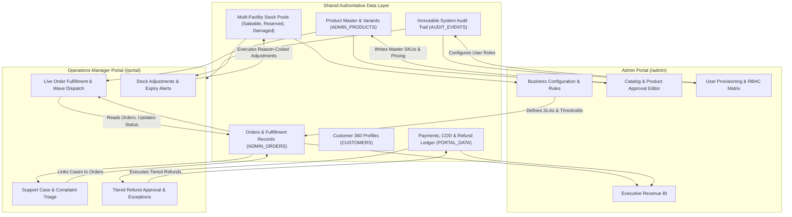

# HyperMart — Two-Portal Architecture & Route Classification Specification
**Document Version:** 1.0.0  
**Status:** Architecture Blueprint & Route Classification  
**Target Architecture:**
1. **Admin Portal** (`/admin`) — Business Configuration, Merchandising, Governance & Control
2. **Operations Manager Portal** (`/portal`) — Real-time Execution, Orders, Warehousing, Support & Finance Monitoring

---

## 1. Architectural Principles & Separation of Responsibilities

| Dimension | Admin Portal (`/admin`) | Operations Manager Portal (`/portal`) |
| :--- | :--- | :--- |
| **Primary Mandate** | **Configuration & Governance** (Define *how* HyperMart runs) | **Execution & Resolution** (Monitor & coordinate *what* happens daily) |
| **Typical Persona** | Super Admin (Dev K.), Catalogue Editor (Priya N.) | Operations Manager (Priya S.), Warehouse Lead (Arjun M.), Support/Finance Leads |
| **Data Interaction** | Authoritative write on Master Data (SKUs, Pricing, Rules, Users) | Operational execution & state transition (Pick, Pack, Triage, Route, Reassign) |
| **Scope of Authority** | Catalog publishing, commission rates, business thresholds, RBAC | Order flow tracking, inventory alerts, case escalations, exception retries |
| **Sidebar Theme** | Classic Forest Navy Green (`#073922`), Collapsible (248px/76px) | Deep Emerald Green (`#053221`) with Lime-tint Active Pills (`#C6F04A`) (310px) |
| **Underlying Data** | **Single Source of Truth** (`src/mocks/adminData.ts`, `src/mocks/portalData.ts`, unified store) | **Single Source of Truth** (Shared SKU master, Orders, Inventory pools, Audit trail) |

---

## 2. Complete Page-by-Page Route Classification

Every existing page across `/admin` and `/portal` is classified below, detailing source, destination, navigation group, permissions, data models, and migration action.

### 2.1 Admin Portal Pages (`/admin`)

| # | Current Route | Target Route | Navigation Group | Primary Role | Required Permissions | Data Dependencies | Outbound Deep Links | Migration Action |
|:-:|:---|:---|:---|:---|:---|:---|:---|:---|
| 1 | `/admin/login` | `/admin/login` | *Auth Shell* | All Personas | Unauthenticated / Public | `ADMIN_USERS` | `/admin`, `/portal` | **Retain**: Core login gateway; redirects to `/admin` or `/portal` by role. |
| 2 | `/admin/access-denied` | `/admin/access-denied` | *Security Shell* | Restricted Operator | Authenticated | User session | `/admin`, `/portal` | **Retain**: Fallback gate with workspace switcher. |
| 3 | `/admin` *(Ops Dashboard)* | `/admin` *(Business Dashboard)* | **A. Business Overview** | Super Admin, Catalog Editor | `admin:view_dashboard` | Catalog stats, Users, Brand count, Revenue totals | `/admin/products`, `/admin/approvals`, `/admin/users`, `/admin/reports` | **Retain Route, Re-scope Content**: Shows business governance overview; operational execution moves to `/portal`. |
| 4 | `/admin/catalogue` | `/admin/catalogue` | **B. Catalogue Management** | Catalog Editor, Admin | `catalog:view`, `catalog:edit` | Categories, SKU counts, Margin summaries | `/admin/products`, `/admin/approvals` | **Retain**: Master department & category portfolio health. |
| 5 | `/admin/products` | `/admin/products` | **B. Catalogue Management** | Catalog Editor, Admin | `catalog:manage_products` | Master SKU list, inventory flags, price lists | `/admin/products/[id]`, `/admin/products/new`, `/admin/approvals` | **Retain**: Product catalog table & bulk management. |
| 6 | `/admin/products/[id]` | `/admin/products/[id]` | **B. Catalogue Management** | Catalog Editor, Admin | `catalog:edit_product` | Detailed SKU model, variants, FSSAI certificates | `/admin/products`, `/admin/brands` | **Retain**: Full product & variant configuration editor. |
| 7 | `/admin/products/new` | `/admin/products/new` | **B. Catalogue Management** | Catalog Editor, Admin | `catalog:create_product` | Empty SKU draft model, category taxonomy | `/admin/products` | **Retain**: New product drafting wizard. |
| 8 | `/admin/approvals` | `/admin/approvals` | **B. Catalogue Management** | Merchandising QA, Admin | `catalog:approve_products` | Pending approval queue, compliance docs | `/admin/products/[id]` | **Retain**: Catalog quality assurance & approval queue. |
| 9 | `/admin/brands` | `/admin/brands` | **B. Catalogue Management** | Procurement Lead, Admin | `procurement:manage_brands` | Brand contracts, supply terms, commission rates | `/admin/products`, `/admin/purchase-orders` | **Retain**: Supplier agreements & brand registry. |
| 10 | `/admin/promotions` | `/admin/promotions` | **C. Merchandising** | Marketing Lead, Admin | `promotions:manage` | Coupon codes, flash deals, bundle discounts | `/admin/products` | **Retain**: Campaign manager & promotional rules. |
| 11 | *(Embedded in Settings)* | `/admin/settings#rules` | **D. Business Rules** | Super Admin | `settings:manage_rules` | `deliveryRules`, `codRules`, return policy | `/admin/settings` | **Retained inside Settings**: Return policies, delivery thresholds, COD caps. |
| 12 | `/admin/users` | `/admin/users` | **E. Governance** | Super Admin | `users:manage_rbac` | System users, roles, 2FA status, access scopes | `/admin/audit`, `/admin/settings` | **Retain**: User directory & RBAC permission matrix. |
| 13 | `/admin/audit` | `/admin/audit` | **E. Governance** | Super Admin, Compliance | `audit:view_system` | Unified immutable system audit trail | `/admin/users`, `/admin/settings` | **Retain**: Authoritative administrative event log. |
| 14 | `/admin/settings` | `/admin/settings` | **E. Governance** | Super Admin | `settings:manage` | Global operational thresholds, 2FA, SLAs | `/admin/users`, `/admin/audit` | **Retain**: System-wide parameters & business controls. |
| 15 | `/admin/reports` | `/admin/reports` | **F. Reports** | Super Admin, Ops Director | `reports:view_business` | Domain sales, executive revenue, financial trends | `/admin/catalogue`, `/admin/orders` | **Retain**: High-level executive & commercial BI analytics. |

---

### 2.2 Operations Manager Portal Pages (`/portal`)

| # | Current Route | Target Route | Canonical Route | Navigation Group | Primary Role | Required Permissions | Outbound Deep Links | Migration Action |
|:-:|:---|:---|:---|:---|:---|:---|:---|:---|
| 16 | `/portal` *(Redirect)* | `/portal` | `/portal` | **A. Operations Overview** | Operations Manager | `ops:view_dashboard` | `/portal/exceptions`, `/portal/orders`, `/portal/fulfilment` | **Update Target**: Hosts the live Command Operations Dashboard (transferred from `/admin`). |
| 17 | `/admin/exceptions` | `/portal/exceptions` | `/portal/exceptions` | **A. Operations Overview** | Ops Manager, Triage Lead | `ops:triage_exceptions` | `/portal/orders/[id]`, `/portal/returns` | **Migrate with 307 Redirect**: Multi-department exception queue. |
| 18 | `/admin/orders` | `/portal/orders` | `/portal/orders` | **B. Orders & Fulfilment** | Ops Manager, Dispatch Lead | `orders:view_all` | `/portal/orders/[id]`, `/portal/customer-care` | **Migrate with 307 Redirect**: Live customer orders stream. |
| 19 | `/admin/orders/[id]` | `/portal/orders/[id]` | `/portal/orders/[id]` | **B. Orders & Fulfilment** | Ops Lead, Support Agent | `orders:inspect_detail` | `/portal/orders`, `/portal/customers/[id]`, `/portal/refund-processing` | **Migrate with 307 Redirect**: 360-degree order inspection. |
| 20 | `/admin/fulfilment` | `/portal/fulfilment` | `/portal/fulfilment` | **B. Orders & Fulfilment** | Logistics Manager, Hub Lead | `logistics:manage_fleet` | `/portal/orders`, `/portal/warehouse-readiness` | **Migrate with 307 Redirect**: Delivery control tower & vehicle dispatch. |
| 21 | `/admin/returns` | `/portal/returns` | `/portal/returns` | **B. Orders & Fulfilment** | Reverse Logistics Lead | `returns:process_rto` | `/portal/orders/[id]`, `/portal/support/returns` | **Migrate with 307 Redirect**: Delivery returns & driver doorstep triage. |
| 22 | `/admin/inventory` | `/portal/inventory` | `/portal/inventory` | **C. Inventory & Warehouse** | Warehouse Lead, Ops Lead | `inventory:view_pools` | `/portal/inventory/ledger`, `/portal/inventory/alerts` | **Migrate with 307 Redirect**: Multi-warehouse stock pools. |
| 23 | `/admin/inventory/ledger` | `/portal/inventory/ledger` | `/portal/inventory/ledger` | **C. Inventory & Warehouse** | Inventory Auditor, Warehouse Lead | `inventory:audit_stock` | `/portal/inventory`, `/portal/purchase-orders` | **Migrate with 307 Redirect**: Stock ledger & manual adjustment drawer. |
| 24 | `/admin/inventory/alerts` | `/portal/inventory/alerts` | `/portal/inventory/alerts` | **C. Inventory & Warehouse** | Inventory Lead, Procurement | `inventory:manage_alerts` | `/portal/inventory`, `/portal/purchase-orders` | **Migrate with 307 Redirect**: Stockout & batch expiry workbench. |
| 25 | `/admin/purchase-orders` | `/portal/purchase-orders` | `/portal/purchase-orders` | **C. Inventory & Warehouse** | Inbound Dock Supervisor | `procurement:receive_po` | `/portal/inventory`, `/admin/brands` | **Migrate with 307 Redirect**: Inbound PO tracking & dock receiving. |
| 26 | `/admin/warehouse-readiness` | `/portal/warehouse-readiness` | `/portal/warehouse-readiness` | **C. Inventory & Warehouse** | Warehouse Floor Manager | `warehouse:manage_floor` | `/portal/fulfilment`, `/portal/orders` | **Migrate with 307 Redirect**: Live facility telemetry & wave control room. |
| 27 | `/admin/customer-care` | `/portal/customer-care` | `/portal/customer-care` | **D. Customer Operations** | Support Lead, Agent | `support:live_chat` | `/portal/orders/[id]`, `/portal/customers/[id]` | **Migrate with 307 Redirect**: 3-column live agent customer desk. |
| 28 | `/admin/customers/[id]` | `/portal/customers/[id]` | `/portal/customers/[id]` | **D. Customer Operations** | Support Agent, Ops Lead | `customers:view_profile` | `/portal/orders`, `/portal/customer-care` | **Migrate with 307 Redirect**: Customer 360 profile & lifetime metrics. |
| 29 | `/portal/support` | `/portal/support` | `/portal/support` | **E. Support Management** | Support Lead, Agent | `support:view_cases` | `/portal/complaints`, `/portal/escalations` | **Retain**: Support Case Dashboard. |
| 30 | `/portal/complaints` | `/portal/support/cases/[id]` | `/portal/complaints` | **E. Support Management** | Senior Support Agent | `support:investigate_complaint` | `/portal/orders/[id]`, `/portal/refund-processing` | **Retain canonical `/portal/complaints`**; provide alias `/portal/support/cases/[id]`. |
| 31 | `/portal/returns-refunds` | `/portal/support/returns` | `/portal/returns-refunds` | **E. Support Management** | Returns Support Agent | `support:authorise_return` | `/portal/orders/[id]`, `/portal/refund-processing` | **Retain canonical `/portal/returns-refunds`**; provide alias `/portal/support/returns`. |
| 32 | `/portal/warranty-repair` | `/portal/support/warranty` | `/portal/warranty-repair` | **E. Support Management** | Technical Support Agent | `support:schedule_repair` | `/portal/orders/[id]` | **Retain canonical `/portal/warranty-repair`**; provide alias `/portal/support/warranty`. |
| 33 | `/portal/escalations` | `/portal/escalations` | `/portal/escalations` | **E. Support Management** | Support Manager | `support:handle_escalations` | `/portal/complaints`, `/portal/team-performance` | **Retain**: Critical customer & operational escalation workbench. |
| 34 | `/portal/payment-ledger` | `/portal/finance/payments` | `/portal/payment-ledger` | **F. Finance Monitoring** | Finance Analyst | `finance:view_ledger` | `/portal/payment-exceptions`, `/portal/cod-settlement` | **Retain canonical `/portal/payment-ledger`**; provide alias `/portal/finance/payments`. |
| 35 | `/portal/cod-settlement` | `/portal/finance/cod` | `/portal/cod-settlement` | **F. Finance Monitoring** | Finance Analyst, Cashier | `finance:settle_cod` | `/portal/payment-ledger`, `/portal/fulfilment` | **Retain canonical `/portal/cod-settlement`**; provide alias `/portal/finance/cod`. |
| 36 | `/portal/refund-processing` | `/portal/finance/refunds` | `/portal/refund-processing` | **F. Finance Monitoring** | Finance Officer, Dual Approver | `finance:process_refund` | `/portal/orders/[id]`, `/portal/audit-history` | **Retain canonical `/portal/refund-processing`**; provide alias `/portal/finance/refunds`. |
| 37 | `/portal/payment-exceptions` | `/portal/finance/exceptions` | `/portal/payment-exceptions` | **F. Finance Monitoring** | Finance Operations Lead | `finance:retry_exceptions` | `/portal/payment-ledger`, `/portal/orders/[id]` | **Retain canonical `/portal/payment-exceptions`**; provide alias `/portal/finance/exceptions`. |
| 38 | `/portal/reconciliation-reports` | `/portal/reconciliation-reports` | `/portal/reconciliation-reports` | **F. Finance Monitoring** | Finance Manager | `finance:reconciliation` | `/portal/payment-ledger` | **Retain**: Bank statement & gateway reconciliation reports. |
| 39 | `/portal/audit-history` | `/portal/audit-history` | `/portal/audit-history` | **G. Reporting & Governance** | Governance Auditor, Ops Lead | `audit:view_operations` | `/portal/support`, `/portal/finance/refunds` | **Retain**: Operational action & financial audit history. |
| 40 | `/portal/team-performance` | `/portal/team-performance` | `/portal/team-performance` | **G. Reporting & Governance** | Ops Manager, Support Manager | `team:view_performance` | `/portal/support`, `/portal/complaints` | **Retain**: Agent workload balancing & productivity dashboard. |

---

## 3. Proposed Navigation & Sidebar Structures

### 3.1 Admin Portal Sidebar (`/admin`)
*Visual Specification: Fixed 248px width (collapsible to 76px), deep forest green background (`#073922`), white text with lime-accent indicators.*

```text
HyperMart Operations Hub (Admin Portal)
│
├── A. BUSINESS OVERVIEW
│   └── Business Dashboard          -> /admin
│
├── B. CATALOGUE MANAGEMENT
│   ├── Catalogue Overview          -> /admin/catalogue
│   ├── Products & Master SKUs      -> /admin/products
│   ├── Product Approvals (QA)      -> /admin/approvals    [Badge: 12]
│   └── Brands & Procurement        -> /admin/brands
│
├── C. MERCHANDISING
│   └── Offers & Promotions         -> /admin/promotions
│
├── D. BUSINESS RULES
│   ├── Operational Parameters      -> /admin/settings#thresholds
│   ├── Return & Delivery Policies  -> /admin/settings#policies
│   └── Categories & Taxonomy       -> /admin/catalogue#taxonomy
│
├── E. GOVERNANCE
│   ├── Users & Permissions (RBAC)  -> /admin/users
│   ├── System Audit Log            -> /admin/audit
│   └── System Settings             -> /admin/settings
│
└── F. REPORTS
    └── Business & Revenue Reports  -> /admin/reports
```

### 3.2 Operations Manager Portal Sidebar (`/portal`)
*Visual Specification: Fixed 310px width, deep forest green background (`#053221`), active lime-tint highlight pill (`#C6F04A`), multi-facility status strip.*

```text
HyperMart Operations Portal (Operations Manager)
│
├── A. OPERATIONS OVERVIEW
│   ├── Operations Dashboard        -> /portal
│   └── Exception Queue             -> /portal/exceptions          [Badge: 5 critical]
│
├── B. ORDERS & FULFILMENT
│   ├── Orders Stream               -> /portal/orders
│   ├── Fulfilment Control Tower    -> /portal/fulfilment
│   └── Returns & Reverse Logistics -> /portal/returns             [Badge: 14]
│
├── C. INVENTORY & WAREHOUSE
│   ├── Multi-Facility Inventory    -> /portal/inventory
│   ├── Stock Ledger & Adjustments  -> /portal/inventory/ledger
│   ├── Low Stock & Expiry Alerts   -> /portal/inventory/alerts    [Badge: 7]
│   ├── Purchase Orders             -> /portal/purchase-orders
│   └── Warehouse Readiness (Live)  -> /portal/warehouse-readiness [Indicator: Live DC]
│
├── D. CUSTOMER OPERATIONS
│   ├── Customer Care Live Desk     -> /portal/customer-care       [Badge: 24 active]
│   └── Customer 360 Lookup         -> /portal/customers/c-101
│
├── E. SUPPORT MANAGEMENT
│   ├── Support Case Dashboard      -> /portal/support             [Badge: 28]
│   ├── Complaint Cases             -> /portal/complaints          [Badge: 5 at risk]
│   ├── Returns & Refunds Support   -> /portal/returns-refunds     [Badge: 14]
│   ├── Warranty & Repair Support   -> /portal/warranty-repair     [Badge: 8]
│   └── Escalations Management      -> /portal/escalations         [Badge: 4 critical]
│
├── F. FINANCE MONITORING
│   ├── Payment Ledger              -> /portal/payment-ledger
│   ├── COD Settlement              -> /portal/cod-settlement      [Badge: 2 holds]
│   ├── Refund Processing           -> /portal/refund-processing   [Badge: 12]
│   ├── Payment Exceptions          -> /portal/payment-exceptions  [Badge: 9 retry]
│   └── Reconciliation Reports      -> /portal/reconciliation-reports
│
└── G. OPERATIONAL REPORTING & GOVERNANCE
    ├── Audit History               -> /portal/audit-history
    └── Team Performance            -> /portal/team-performance    [Badge: 14 active]
```

---

## 4. Shared Data Architecture & Store Alignment

To ensure that both portals operate on the **same single source of truth**, data models and state management are connected as follows:



### Refund Approval Matrix Enforcement
Regardless of whether an action is initiated from `/portal/refund-processing`, `/portal/support`, or `/admin/orders/[id]`:
- **Tier 1 (< ₹500)**: Auto-approvable by Support Agents with doorstep photo evidence.
- **Tier 2 (₹500 – ₹2,000)**: Requires Operations Manager sign-off.
- **Tier 3 (> ₹2,000)**: Requires Super Admin dual sign-off.

---

## 5. Backward Compatibility & Redirect Strategy

To ensure zero broken links, bookmarks, or notifications, Next.js route redirects will be established:

| Legacy Route | Target Canonical Route | HTTP Status | Notes |
| :--- | :--- | :--- | :--- |
| `/admin/exceptions` | `/portal/exceptions` | 307 Temporary / 308 Permanent | Operational exception queue |
| `/admin/orders` | `/portal/orders` | 307 Temporary / 308 Permanent | Customer order stream |
| `/admin/orders/:id` | `/portal/orders/:id` | 307 Temporary / 308 Permanent | Dynamic order inspection |
| `/admin/fulfilment` | `/portal/fulfilment` | 307 Temporary / 308 Permanent | Control tower |
| `/admin/returns` | `/portal/returns` | 307 Temporary / 308 Permanent | Reverse logistics |
| `/admin/inventory` | `/portal/inventory` | 307 Temporary / 308 Permanent | Inventory overview |
| `/admin/inventory/ledger` | `/portal/inventory/ledger` | 307 Temporary / 308 Permanent | Stock ledger |
| `/admin/inventory/alerts` | `/portal/inventory/alerts` | 307 Temporary / 308 Permanent | Stockout alerts |
| `/admin/purchase-orders` | `/portal/purchase-orders` | 307 Temporary / 308 Permanent | Purchase orders |
| `/admin/warehouse-readiness` | `/portal/warehouse-readiness` | 307 Temporary / 308 Permanent | Live facility telemetry |
| `/admin/customer-care` | `/portal/customer-care` | 307 Temporary / 308 Permanent | Customer support desk |
| `/admin/customers/:id` | `/portal/customers/:id` | 307 Temporary / 308 Permanent | Customer 360 profiles |
| `/admin/refunds` | `/portal/refund-processing` | 307 Temporary / 308 Permanent | Tiered refund approvals |
| `/admin/payments` | `/portal/payment-ledger` | 307 Temporary / 308 Permanent | Payment ledger |
| `/portal/support/cases/:id` | `/portal/complaints` | Internal Route / Alias | Direct link backward compatibility |
| `/portal/support/returns` | `/portal/returns-refunds` | Internal Route / Alias | Direct link backward compatibility |
| `/portal/support/warranty` | `/portal/warranty-repair` | Internal Route / Alias | Direct link backward compatibility |
| `/portal/finance/payments` | `/portal/payment-ledger` | Internal Route / Alias | Direct link backward compatibility |
| `/portal/finance/cod` | `/portal/cod-settlement` | Internal Route / Alias | Direct link backward compatibility |
| `/portal/finance/refunds` | `/portal/refund-processing` | Internal Route / Alias | Direct link backward compatibility |
| `/portal/finance/exceptions` | `/portal/payment-exceptions` | Internal Route / Alias | Direct link backward compatibility |

---

## 6. Execution Roadmap (Controlled Phases)

1. **Phase 1: Architecture Review (Current Step)**
   - Review and align on the route classification, sidebar structures, and redirect mappings.
2. **Phase 2: Portal Shell & Topbar Unification**
   - Update `AdminSidebar.tsx` to display Admin-only items (Catalog, Merchandising, Governance, Reports).
   - Update `PortalSidebar.tsx` to display the full Operations Manager hierarchy (Operations, Fulfilment, Inventory, Support, Finance, Performance).
   - Add workspace switcher ("Switch to Operations Portal" / "Switch to Admin Portal") in both top navigation bars.
3. **Phase 3: Route Migration to `/portal`**
   - Move or re-export operational pages (`exceptions`, `orders`, `fulfilment`, `returns`, `inventory`, `purchase-orders`, `warehouse-readiness`, `customer-care`, `customers`) under `/portal`.
   - Setup Next.js App Router redirects from `/admin/*` to `/portal/*` for operational pages.
4. **Phase 4: Admin Business Overview Dashboard**
   - Establish `/admin` as the Business Configuration Overview (Catalog health, pending QA approvals, active promotions, user access, and system governance).
   - Establish `/portal` as the Operations Command Dashboard (transferred directly from existing `/admin` without visual loss).
5. **Phase 5: Shared Data & Verification**
   - Verify that updates made in one portal (e.g. refund approval in `/portal`, or price change in `/admin`) immediately reflect across all screens.
   - Run typecheck, lint, and end-to-end route verification.

